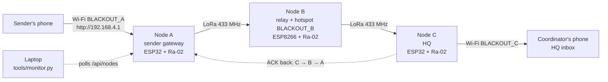
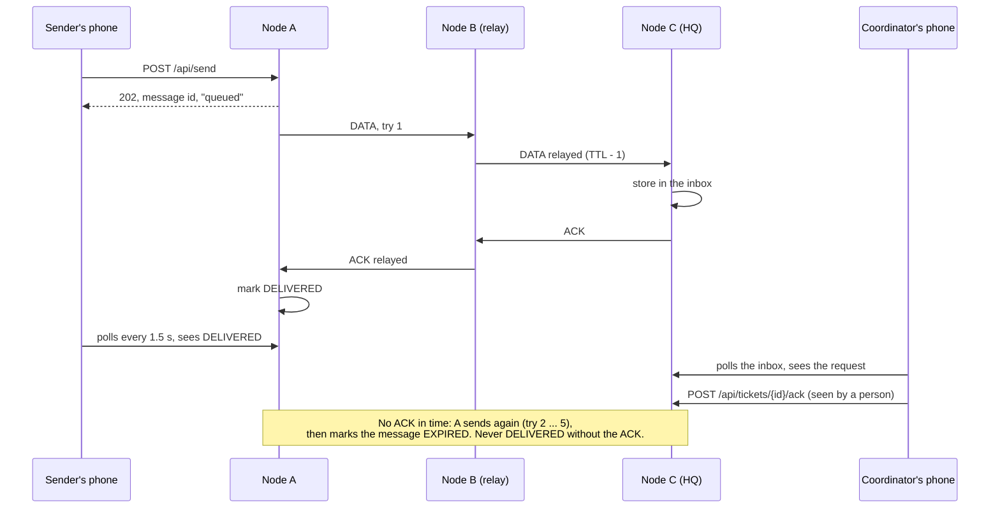
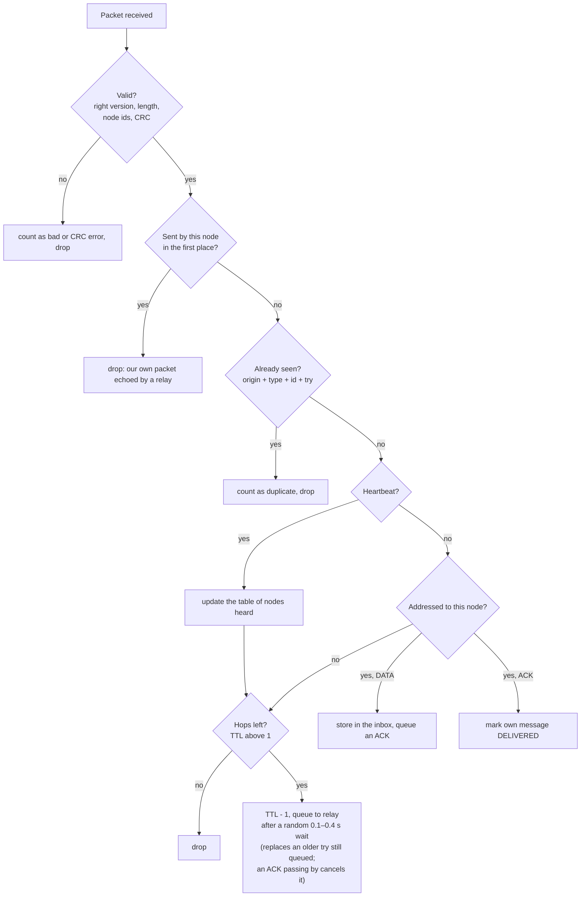
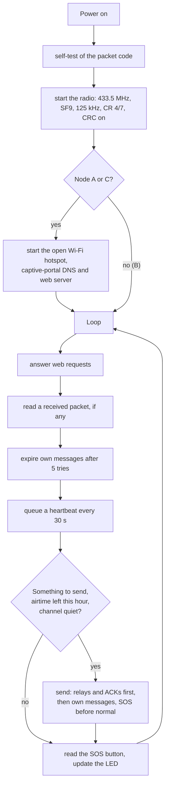
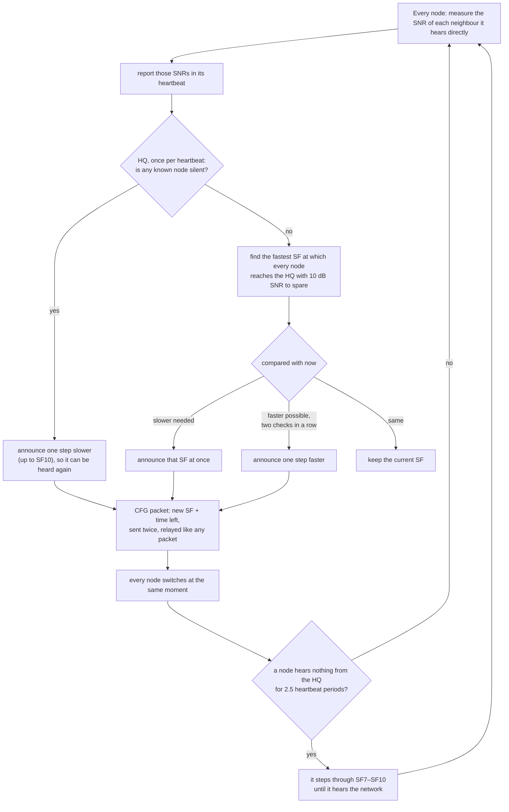
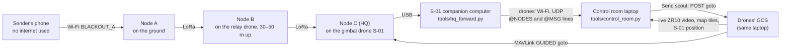
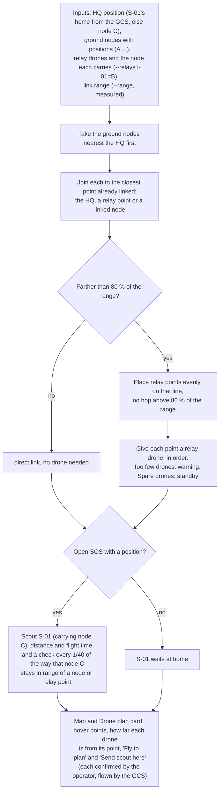

# BLACKOUT NET: project plan

An offline emergency-message system. A person near node A joins its Wi-Fi with an ordinary phone, sends a
short request, and the request travels over 433 MHz LoRa radio, A → B → C, to the coordinators at node C.
Node A reports DELIVERED only when node C's confirmation has come back the same way. No internet or mobile
network is used at any point.

Why each choice was made, and what was rejected, is in [decision.md](decision.md).

## 1. System overview



Three nodes in a line give one path only. If B fails while A cannot hear C, delivery stops until B is back.

## 2. Life of one message



## 3. What a node does with a packet it receives



## 4. Main loop of every node



## 4b. Phase 2: adaptive spreading factor

The code comes in two phases so faults are easy to place. **Phase 1** (`firmware/`) is the complete
system on a fixed setting. **Phase 2** (`firmware-phase2/`) is phase 1 plus adaptive spreading factor (SF):
the network runs faster when every link is strong and slower when one is weak. Test phase 1 first; a
fault that appears only in phase 2 is in the adaptive part. All nodes must run the same phase.



## 4c. Drones, control room and the sender's location

Three nodes, two of them flying:

- **Node A** stays on the ground where people are. Phones join its Wi-Fi and send SOS messages.
- **Node B** rides on an ordinary drone hovering 30–50 m up, so the hops can be longer: a raised antenna
  clears the buildings and trees that limit LoRa range most.
- **Node C (the HQ)** rides on the big drone with the gimbal camera (S-01 in the GCS). It plugs into that
  drone's companion computer by USB; `tools/hq_forward.py` there sends everything node C prints to the
  control room over the drones' Wi-Fi.
- **The control room** is the laptop running the drones' GCS and `tools/control_room.py`: a map of every node,
  every message with where the sender is, the live gimbal camera from the GCS, and a "Send scout here" button
  that flies S-01 to the sender through the GCS. Messages reach it only from node C's USB (on the bench, node C
  plugged into the laptop); with another node on USB the page shows a red alert.



```mermaid
sequenceDiagram
    participant Phone as Sender's phone
    participant A as Node A
    participant B as Node B (relay drone)
    participant C as Node C (HQ on S-01)
    participant CR as Control room
    participant GCS as Drones' GCS
    Phone->>A: SOS "2 hurt" at "school gate"
    A->>A: notes the phone's Wi-Fi signal (-71 dBm)
    A->>B: DATA (LoRa)
    B->>C: DATA relayed
    C->>CR: @MSG line: text, landmark, A's position, phone signal
    C->>B: ACK
    B->>A: ACK relayed, phone shows DELIVERED
    CR->>CR: SOS on the map: node A plus a circle of about 35 m
    CR->>GCS: operator presses "Send scout here"
    GCS->>C: S-01 flies there (GUIDED); its camera shows the spot live in the control room
```

### Drone plan: where each drone should be

The control room works out, every second, where each drone has to be for the mesh to hold, and shows it as
a "virtual" plan on the map (dashed purple points, links and range circles) before anyone flies.



**Mission planner tab (virtual).** For any SOS with a position, the control room plans the whole response:
distance, relay drones needed, each drone's launch time, height layer, route, time on station and battery,
and when the mesh reaches the site. ARM runs it as a simulation on the real map with a timeline and a log.
Nothing is sent to any drone; it shows the plan before the nodes are mounted on the drones. From ARM to
touchdown the scout's camera stays on the SOS site (tilt and zoom from its height and distance); a switch (on
by default) lets the real ZR10 follow the run, camera commands only. The live camera and its controls (pad,
zoom, pan, tilt, focus, aim, photo, record, as on the GCS's Vision page) appear under the Run card.

Order in the field: fly the relay drones to their points first ("on station"), then send the scout. If the
check says node C would lose the mesh on the way, messages wait until it is back in reach.

### Where the sender is, without using their internet

1. **Node A's own position,** typed in once over USB (`pos 28.749912 77.116403`) or set in
   `platformio.ini`; every heartbeat carries it. Nodes B and C need nothing: the control room shows them at
   their drones' live GPS positions from the GCS.
2. **How far the phone is from node A.** Node A measures the sender's phone's Wi-Fi signal when the message
   arrives and sends it along (1 byte). The control room turns it into a search circle: about 10 m for a
   strong signal, up to 150 m for a weak one. A rough guide, not a fix.
3. **The landmark** the sender types.

The phone's own GPS is not used: browsers give location only to HTTPS pages, and the node's page is plain
HTTP with no internet. See decision.md.

### Delhi-wide showcase

`python tools/city_plan.py` puts a node at every site (a 1 km grid over Delhi until the real flag-mast
positions are given with `--sites flags.csv`), links sites within the measured range, and shows how many hops
each site is from its nearest HQ. With the defaults (1.5 km links, an HQ every 7 km, the firmware's 3-hop
limit): 2,700 sites, 56 HQs, 98 % within 3 hops. It is a planning sketch: today's flooding relay suits a few
dozen nodes, and a whole city needs routing towards the nearest HQ, which is not built.

## 5. Procedure

### 5.1 Parts (per node, three nodes)

| Part | Note |
|---|---|
| ESP32 DevKit V1, 30 pin | classic ESP32-WROOM-32 |
| Ai-Thinker Ra-02 (SX1278, 433 MHz) on a breakout board | all three identical |
| 433 MHz antenna on the Ra-02's I-PEX socket | never transmit without it |
| 100 nF and 10 µF capacitors | across the Ra-02's 3.3 V and GND, close to the module |
| Push button, LED, 220 Ω resistor | SOS button and status light |
| 5 V USB wall charger, 1 A or more, plus a power bank | power bank needed for the blackout demonstration |
| Box with A, B or C written on it | |

### 5.2 Wiring (same on every node)

| Ra-02 pad | Signal | ESP32 pin |
|---|---|---|
| 3 | 3.3 V | 3V3 |
| 1, 2, 9, 16 | GND | GND |
| 15 | NSS | D21 |
| 12 | SCK | D18 |
| 13 | MISO | D19 |
| 14 | MOSI | D23 |
| 4 | RESET | D14 |
| 5 | DIO0 | D26 |
| 6 | DIO1 | D27 |
| — | SOS button to GND | D25 |
| — | LED through 220 Ω to GND | D2 |

### 5.3 Build and flash

1. Install VS Code with the PlatformIO extension and open the `firmware` folder.
2. Plug in one board and flash its role: `pio run -e node_a -t upload` (then `node_b`, `node_c`).
3. Open `pio device monitor` and check for `selftest ok` and `RADIO ok`.
4. Position: type `pos 28.749912 77.116403` (its latitude and longitude, from a maps app) into the serial
   monitor; the node keeps it through restarts. `pos clear` removes it. Or skip this and set it in the control
   room: pick the node above the map, paste the position from a maps app and press Set (or click the map).
   Nodes on drones can skip both.

### 5.4 Bring-up tests, in order

| # | Test | Pass when |
|---|---|---|
| 1 | Power one node | `selftest ok`, `RADIO ok`, LED not slow-blinking |
| 2 | Power a second node | each logs `NEW NODE … heard` within a few seconds |
| 3 | Phone joins `BLACKOUT_A` | the page opens by itself, or at http://192.168.4.1 |
| 4 | Send a message with all three nodes on one table | DELIVERED on the phone, ticket in C's inbox |
| 5 | Press the SOS button on A | LED blinks fast, then stays on 3 s; SOS ticket appears at C |
| 6 | Turn C off, send | WAITING FOR HQ, then NOT DELIVERED; never DELIVERED |
| 7 | Laptop on `BLACKOUT_A`, run `python tools/monitor.py` | B and C listed online with signal figures |
| 8 | Node C on the laptop's USB, `python tools/control_room.py --serial COM5` | A and B on the map; a phone's SOS appears with its search circle |
| 9 | Node C on S-01's companion computer running `hq_forward.py`; laptop runs `control_room.py --udp 15100 --gcs http://localhost:8765` | the same, plus S-01's live video and position |

### 5.5 Prove the two hops

1. Place A and C so they cannot hear each other but both hear B (a building between them, or distance).
2. Check A's Network tab: C must show "via B", never "direct".
3. Send a message and keep all three serial logs. The same message id must appear as
   `TX DATA` on A, `RELAY DATA` and `RELAY ACK` on B, `INBOX` and `TX ACK` on C, and `DELIVERED` on A.
4. Turn B off and send: it must not be delivered. Turn B back on during the retries: it is delivered on a
   later try. This shows retrying, not rerouting.

For bench work only, `BENCH_BLOCK_DIRECT=1` makes A and C ignore each other's direct packets. It fakes the
distance and must be stated if shown.

### 5.6 Measure

| Measurement | How |
|---|---|
| SOS priority against FIFO | `python tools/priority_test.py` on `BLACKOUT_A`: 20 normal + 3 SOS, with priority on and off |
| Delivery rate, latency, retries | Network tab counters and the message list |
| Heartbeat loss and signal over time | `heartbeats.csv` written by the monitor |
| Range | move a node away step by step, note distance, RSSI, SNR and delivery |
| Battery life | run a node from a power bank until it stops |
| Phase 2: adaptive SF against fixed SF9 | `python tools/adaptive_test.py fixed`, then `adaptive`, nodes not moved between runs; see `firmware-phase2/README.md` |
| Relay drone: range gained by height | section 5.8: `python tools/relay_compare.py ground.csv air.csv` |
| Scout drone: SOS to camera on the spot | section 5.8: time of the SOS press to the moment the video shows the spot |
| Sender distance guide | walk a phone away from node A, note its signal in the control room against the real distance |
| Link budget and path-loss exponent | range-test readings into `electronics/range_test.csv`, then `python electronics/link_budget.py` |

Report the counts, the settings (SF9, 125 kHz, 8 dBm setting, antennas, heights, distances) and only
figures that were measured.

### 5.7 Demonstration (about 2 minutes)

1. Three boxes on power banks, laptop unplugged. Phone with mobile data off.
2. A judge joins `BLACKOUT_A` and sends their own text.
3. Show it arriving in C's inbox and DELIVERED on the judge's phone, with the relay in the log.
4. Press the physical SOS button.
5. Turn B off: the message waits and fails honestly. Turn it back on: it goes through.
6. Show the priority-test numbers.
7. Drones (flying is not allowed at the venue): node B on the parked relay drone and node C on the parked
   gimbal drone, both powered by them; the control room on the big screen. A judge's SOS appears on the
   map with its search circle, live. Then play the recorded flights from section 5.8 and show the relay
   comparison table and the city plan (`city_plan.html`).

### 5.8 Drones (flown and recorded before judging)

**Mounting (both drones)**

1. Node B under the relay drone, node C under the gimbal drone S-01. ESP32 `VIN` to the drone's 5 V output,
   `GND` to `GND`. Antenna hanging straight down, as far from motors, ESCs and the drone's own GPS as the
   frame allows. Tie down the board and the antenna lead clear of the propellers.
2. Check every radio on both drones. Anything on 433 MHz (ELRS 433, a 433 MHz telemetry radio) clashes with
   LoRa: do not fly a node on that drone.
3. Node C's USB goes to S-01's companion computer. On it, once: `sudo apt install python3-serial`, copy
   `tools/hq_forward.py` across, then `python3 hq_forward.py --serial /dev/ttyUSB0 --to <laptop IP>:15100`.
4. On the laptop: start the GCS, then
   `python tools/control_room.py --udp 15100 --gcs http://localhost:8765 --scout S-01 --hq-on-scout --relays I-01=B --range 1500`
   (the GCS id of the relay drone and the node it carries; the range measured below). The control room shows
   A, B and C on the map within 10 seconds, and the drone plan with each relay drone's hover point.

**Relay drone: range gained by height**

1. Place A and the control room so A cannot reach C directly with B on the ground (the control room's node
   table shows A "via B", and messages fail when B is switched off).
2. Ground run: relay drone on the ground between them; start the control room with `--csv ground.csv`.
   Send 10 messages from a phone and count DELIVERED. Run for 5 minutes or longer.
3. Air run: the same spot, the drone hovering at 30 m (or the height allowed). Restart the control room with
   `--csv air.csv`, 10 messages, the same length of time.
4. `python tools/relay_compare.py ground.csv air.csv`: heartbeats received, RSSI and SNR, ground against air.
   Keep the table and both delivery counts. Record both runs on video.

**Scout drone: SOS to camera on the spot**

1. A's position must be right: `pos` typed in on node A (the control room's node table shows it).
2. Take off the relay drone, press "Fly to plan" in the Drone plan card and wait for "on station".
3. Take off S-01 from the GCS as usual and hold it near the control room.
4. Send an SOS from a phone near A. It appears in the control room with a search circle, and the Drone plan
   card shows S-01's distance, flight time and whether node C stays in reach of the mesh on the way.
5. Press "Send scout here" and confirm. The GCS flies S-01 there in GUIDED mode; the pilot can take over at
   any time from the GCS or the radio.
6. Watch the live camera in the control room. Record the screen; note the time from the SOS press to the
   spot on camera (`messages.jsonl` keeps when the SOS arrived and when the scout was sent).

Without any hardware: `python tools/control_room.py --mock` runs a fake node C and a fake GCS.

## 6. Status (15 November 2026)

| Item | State |
|---|---|
| Phase 1 firmware for A, B and C | uploaded to all three boards (ESP32 and NodeMCU ESP8266, Arduino IDE). Node B checked on the bench: starts, hotspot `BLACKOUT_B` up, hears node A at -38 dBm and relays its heartbeats. End-to-end delivery not yet confirmed |
| Phase 2 firmware (adaptive SF) | running on all three nodes; the HQ switched the network SF9 → SF8 → SF7 by itself. Final build (one copy of a message per queue, ACK cancels leftovers) uploaded to B and C on 15 November, self-test ok, C hears A and B; node A still on the previous phase 2 build until it is plugged in |
| `pos` USB command, `@NODES`/`@MSG` lines, phone signal (both phases) | written, all six builds compile (PlatformIO and Arduino IDE); position parsing self-checked at every start; **not yet run on real boards** |
| Adaptive SF test script | written, not yet run (needs the radios) |
| Phone page (send, HQ inbox, network) | written, checked in a browser against a fake node |
| Laptop monitor with map and heartbeat log | written, self-test passes, checked with a fake node |
| Priority test script | written, not yet run (needs the radios) |
| Control room (`tools/control_room.py`) | written, self-test passes; checked in a browser against a fake node C and a fake GCS, scout sent and flown on the fake GCS. Not yet run with node C, the real GCS or S-01 |
| Drone plan in the control room (relay hover points, scout flight check, "Fly to plan") | written, self-test passes; checked against the fake GCS with relay I-01 and S-01 flying. Not yet run with real drones |
| Control room with real hardware | node C found on USB by itself, nodes B and C shown; live ZR10 picture pulled straight from the Jetson (1280×720); nodes placed on the map by clicking. GCS fly-to not yet tried with a real drone |
| Forwarder on S-01 (`tools/hq_forward.py`) | written, not yet run |
| City plan (`tools/city_plan.py`) | written, self-test passes, Delhi grid drawn |
| Electronics analysis (`electronics/`) | 4 Python simulations and 2 LTspice circuits, all run here and checked against theory; figures in `electronics/figures/`. Range-test readings still to be entered |
| Relay comparison (`tools/relay_compare.py`) | written, self-test passes; needs the two flights |
| Relay and scout flights | to do (recorded before the hackathon) |
| Real flag-mast positions for the city plan | to collect |
| Wiring diagram | done |
| Hardware assembly | three nodes built |
| Bring-up tests 1–7 | in progress: tests 1–2 pass on node B |
| Two-hop proof and measurements | to do |
| Enclosures | to do |

## 7. Known limits

- One path only with three nodes; no rerouting if B fails.
- Messages and the inbox are lost when a node loses power.
- Packets are neither encrypted nor signed.
- The coordinator PIN (`COORD_PIN` in `config.h`, default 202611) must be changed before the demo, and is
  sent unencrypted over the open Wi-Fi.
- Message text plus landmark: 37 bytes (about 12 characters of Hindi).
- Transmit power is a conservative 8 dBm setting. The radiated power has not been measured, so there is no
  claim of compliance with the Indian 433 MHz rules yet.
- Range is unknown until measured.
- Phase 2: after a node is switched off or misses an SF switch, finding the network again can take up to
  about 5 minutes. Turn adaptive off for the relay-failure demonstration.
- Phase 2: the whole network uses one SF, set by its weakest needed link, not a different SF per link.
- Sender location: node A's position plus a rough circle from the phone's Wi-Fi signal, and the landmark;
  not the phone's own GPS. The circle uses a fixed model until it is calibrated on site.
- Node C rides on S-01: while S-01 is switched off there is no HQ, and messages expire. The control room
  keeps every message it has received on disk, so a restart of node C loses nothing there.
- The scout flies only when an operator presses "Send scout here" and confirms; S-01 must already be flying.
  Relay drones likewise only on "Fly to plan".
- Drone plan: straight lines and one range for every hop, no terrain, buildings, wind or battery; as good as
  the measured `--range`. It plans for the ground nodes the HQ knows; relays are placed one chain per node.
- The control room accepts lines from anyone on the drones' Wi-Fi (the team's own password-protected
  network).
- City plan: positions are a grid until the real flag masts are given; the link range is an assumption until
  measured; a city-wide network needs routing towards the nearest HQ, which is not built.
- Drones: flights are recorded beforehand, because flying is not allowed at the venue.
