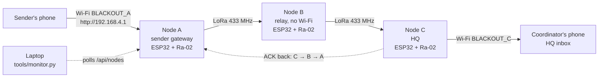
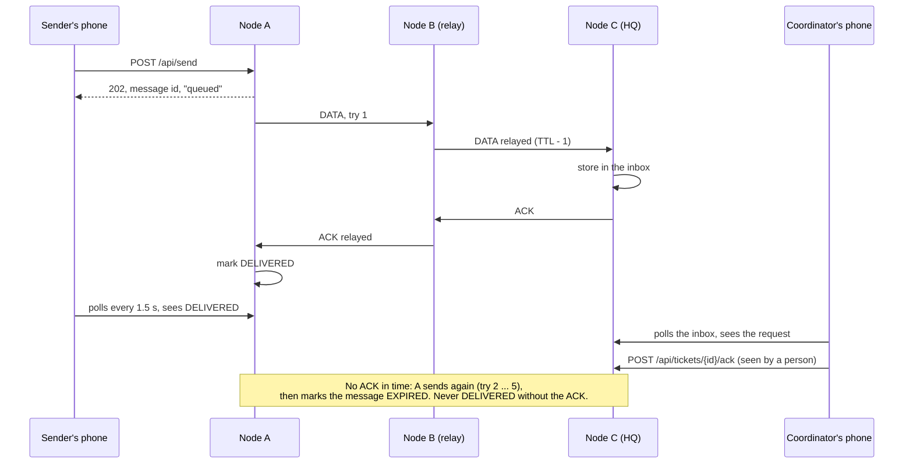
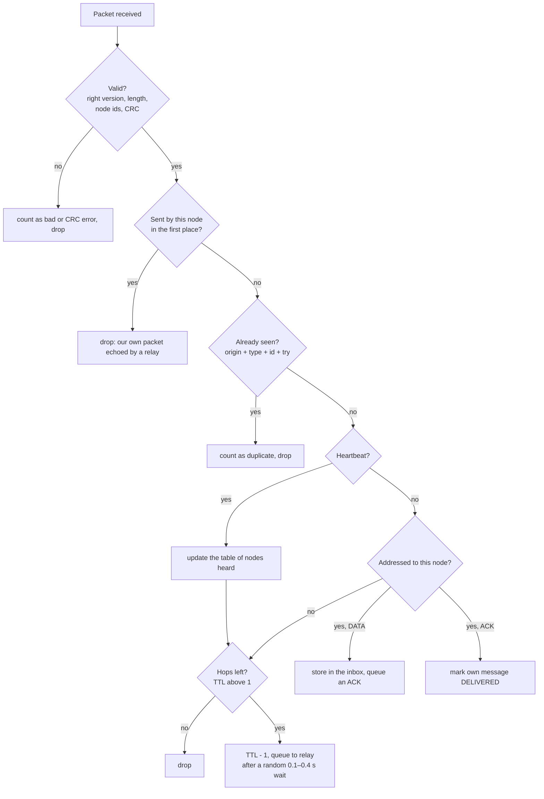
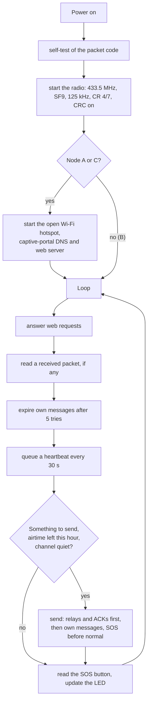

# BLACKOUT NET: project plan

An offline emergency-message system. A person near node A joins its Wi-Fi with an ordinary phone, sends a
short request, and the request travels over 433 MHz LoRa radio, A → B → C, to the coordinators at node C.
Node A reports DELIVERED only when node C's confirmation has come back the same way. No internet or mobile
network is used at any point.

Why each choice was made, and what was rejected, is in [decision.md](decision.md).

## 1. System overview

Three nodes in a line give one path only. If B fails while A cannot hear C, delivery stops until B is back.

## 2. Life of one message

## 3. What a node does with a packet it receives

## 4. Main loop of every node

## 5. Procedure

### 5.1 Parts (per node, three nodes)

| Part | Note |
|---|---|
| ESP32 DevKit V1, 30 pin | classic ESP32-WROOM-32 |
| Ai-Thinker Ra-02 (SX1278, 433 MHz) on a breakout board | all three identical |
| 433 MHz antenna on the Ra-02's I-PEX socket | never transmit without it |
| 100 nF and 10 µF capacitors | across the Ra-02's 3.3 V and GND, close to the module |
| Push button, LED, 220 Ω resistor | SOS button and status light |
| 5 V USB wall charger, 1 A or more, plus a power bank | power bank needed for the blackout demonstration |
| Box with A, B or C written on it | |

### 5.2 Wiring (same on every node)

| Ra-02 pad | Signal | ESP32 pin |
|---|---|---|
| 3 | 3.3 V | 3V3 |
| 1, 2, 9, 16 | GND | GND |
| 15 | NSS | D21 |
| 12 | SCK | D18 |
| 13 | MISO | D19 |
| 14 | MOSI | D23 |
| 4 | RESET | D14 |
| 5 | DIO0 | D26 |
| 6 | DIO1 | D27 |
| — | SOS button to GND | D25 |
| — | LED through 220 Ω to GND | D2 |

### 5.3 Build and flash

1. Install VS Code with the PlatformIO extension and open the `firmware` folder.
2. Optional: put each node's latitude and longitude into `platformio.ini` (`NODE_LAT`, `NODE_LON`) so the
   laptop monitor can draw the map to scale.
3. Plug in one board and flash its role: `pio run -e node_a -t upload` (then `node_b`, `node_c`).
4. Open `pio device monitor` and check for `selftest ok` and `RADIO ok`.

### 5.4 Bring-up tests, in order

| # | Test | Pass when |
|---|---|---|
| 1 | Power one node | `selftest ok`, `RADIO ok`, LED not slow-blinking |
| 2 | Power a second node | each logs `NEW NODE … heard` within a few seconds |
| 3 | Phone joins `BLACKOUT_A` | the page opens by itself, or at http://192.168.4.1 |
| 4 | Send a message with all three nodes on one table | DELIVERED on the phone, ticket in C's inbox |
| 5 | Press the SOS button on A | LED blinks fast, then stays on 3 s; SOS ticket appears at C |
| 6 | Turn C off, send | WAITING FOR HQ, then NOT DELIVERED; never DELIVERED |
| 7 | Laptop on `BLACKOUT_A`, run `python tools/monitor.py` | B and C listed online with signal figures |

### 5.5 Prove the two hops

1. Place A and C so they cannot hear each other but both hear B (a building between them, or distance).
2. Check A's Network tab: C must show "via B", never "direct".
3. Send a message and keep all three serial logs. The same message id must appear as
   `TX DATA` on A, `RELAY DATA` and `RELAY ACK` on B, `INBOX` and `TX ACK` on C, and `DELIVERED` on A.
4. Turn B off and send: it must not be delivered. Turn B back on during the retries: it is delivered on a
   later try. This shows retrying, not rerouting.

For bench work only, `BENCH_BLOCK_DIRECT=1` makes A and C ignore each other's direct packets. It fakes the
distance and must be stated if shown.

### 5.6 Measure

| Measurement | How |
|---|---|
| SOS priority against FIFO | `python tools/priority_test.py` on `BLACKOUT_A`: 20 normal + 3 SOS, with priority on and off |
| Delivery rate, latency, retries | Network tab counters and the message list |
| Heartbeat loss and signal over time | `heartbeats.csv` written by the monitor |
| Range | move a node away step by step, note distance, RSSI, SNR and delivery |
| Battery life | run a node from a power bank until it stops |

Report the counts, the settings (SF9, 125 kHz, 8 dBm setting, antennas, heights, distances) and only
figures that were measured.

### 5.7 Demonstration (about 2 minutes)

1. Three boxes on power banks, laptop unplugged. Phone with mobile data off.
2. A judge joins `BLACKOUT_A` and sends their own text.
3. Show it arriving in C's inbox and DELIVERED on the judge's phone, with the relay in the log.
4. Press the physical SOS button.
5. Turn B off: the message waits and fails honestly. Turn it back on: it goes through.
6. Show the priority-test numbers.

## 6. Status (13 November 2026)

| Item | State |
|---|---|
| Firmware for A, B and C | written, all three compile; **not yet run on real boards** |
| Phone page (send, HQ inbox, network) | written, checked in a browser against a fake node |
| Laptop monitor with map and heartbeat log | written, self-test passes, checked with a fake node |
| Priority test script | written, not yet run (needs the radios) |
| Wiring diagram | done |
| Hardware assembly | to do |
| Bring-up tests 1–7 | to do |
| Two-hop proof and measurements | to do |
| Enclosures | to do |

## 7. Known limits

- One path only with three nodes; no rerouting if B fails.
- Messages and the inbox are lost when a node loses power.
- Packets are neither encrypted nor signed.
- Message text plus landmark: 38 bytes (about 12 characters of Hindi).
- Transmit power is a conservative 8 dBm setting. The radiated power has not been measured, so there is no
  claim of compliance with the Indian 433 MHz rules yet.
- Range is unknown until measured.
